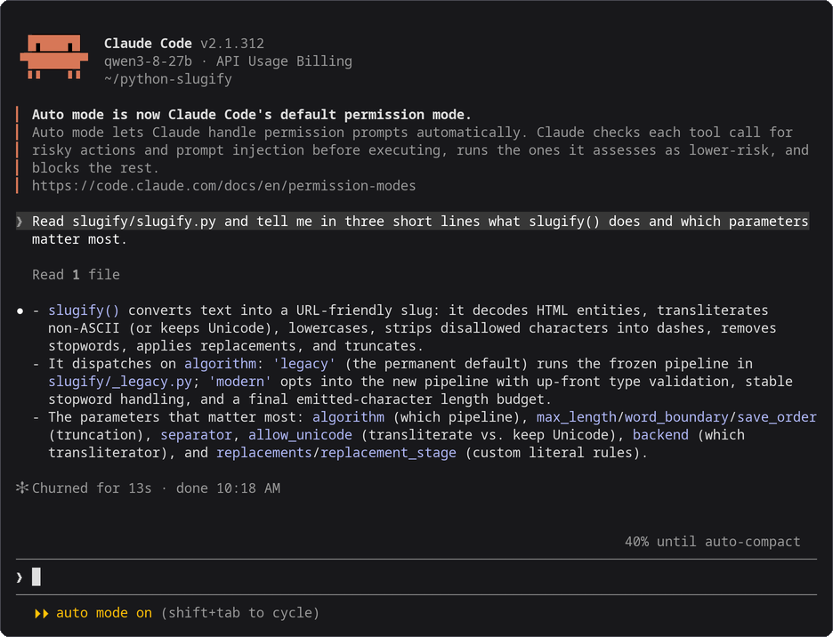

# Claude Code

Claude Code can use a model that `mashbox` serves on your TPU as its LLM. This page sets it up for [Qwen3.8-27B](../models/qwen3-8-27b.md) on one TPU v6e chip, with the settings that let the server reuse the most of each prompt. Your own Claude Code install and your `~/.claude/settings.json` stay as they are: the settings below go in a separate file that you name when you start it. These settings are for Claude Code 2.1.312.



*Claude Code 2.1.312, started with the command in step 2, working against Qwen3.8-27B on a TPU v6e-1. Drawn from the session's terminal text and colours; nothing edited.*

## Before you start

- The `mashbox` server and the SSH tunnel running, from [step 1 of Use with coding agents](../agents-on-tpu.md#1-start-the-server-and-the-tunnel).
- Claude Code installed on your machine.

## 1. Save the settings file

```bash
cat > ~/.claude/mashbox.json <<'EOF'
{
  "env": {
    "ANTHROPIC_BASE_URL": "http://127.0.0.1:8000",
    "ANTHROPIC_AUTH_TOKEN": "local",
    "ANTHROPIC_MODEL": "qwen3-8-27b",
    "ANTHROPIC_SMALL_FAST_MODEL": "qwen3-8-27b",
    "ANTHROPIC_DEFAULT_HAIKU_MODEL": "qwen3-8-27b",
    "ANTHROPIC_DEFAULT_SONNET_MODEL": "qwen3-8-27b",
    "ANTHROPIC_DEFAULT_OPUS_MODEL": "qwen3-8-27b",
    "CLAUDE_CODE_SUBAGENT_MODEL": "qwen3-8-27b",
    "CLAUDE_CODE_ATTRIBUTION_HEADER": "0",
    "CLAUDE_CODE_DISABLE_NONESSENTIAL_TRAFFIC": "1",
    "CLAUDE_CODE_DISABLE_EXPERIMENTAL_BETAS": "1",
    "CLAUDE_CODE_MAX_CONTEXT_TOKENS": "36000",
    "CLAUDE_CODE_MAX_OUTPUT_TOKENS": "4096",
    "CLAUDE_CODE_DISABLE_ADAPTIVE_THINKING": "1",
    "MAX_THINKING_TOKENS": "0"
  },
  "model": "qwen3-8-27b",
  "permissions": {
    "deny": ["Agent", "CronCreate", "CronDelete", "CronList", "EnterWorktree", "ExitWorktree", "ListAgents", "Monitor", "NotebookEdit", "ReportFindings", "ScheduleWakeup", "SendMessage", "Skill", "TaskStop", "WebFetch", "WebSearch", "Workflow"]
  }
}
EOF
```

## 2. Start it

In your project folder:

```bash
claude --settings ~/.claude/mashbox.json --strict-mcp-config
```

`claude` without these options works as before, with your usual settings.

## 3. Check it

```bash
claude --settings ~/.claude/mashbox.json --strict-mcp-config -p "Reply with one word: ready"
```

It ends with `ready`. Before it, Claude Code prints `[claude-code:unrecognized_model]`, a warning that it does not know the model name: Claude Code works.

## What each setting does

| Setting | Why |
|---|---|
| `ANTHROPIC_BASE_URL`, `ANTHROPIC_AUTH_TOKEN` | send every request to the tunnel; the server does not check the token |
| `ANTHROPIC_MODEL`, the five model settings after it and `model` | our model in every role, including Claude Code's short background requests and subagents |
| `CLAUDE_CODE_ATTRIBUTION_HEADER` `0` | leaves out a line Claude Code puts at the top of its system prompt for Anthropic's billing, so the start of the prompt stays the same (see [Caching](#caching)) |
| `CLAUDE_CODE_DISABLE_NONESSENTIAL_TRAFFIC` `1` | no telemetry, update checks or other calls to Anthropic for the session |
| `CLAUDE_CODE_MAX_CONTEXT_TOKENS` `36000`, `CLAUDE_CODE_MAX_OUTPUT_TOKENS` `4096` | Claude Code compacts at about 19,000 tokens (this setting minus the output size minus about 13,000), so its summary still fits in the server's 32,768 |
| `CLAUDE_CODE_DISABLE_ADAPTIVE_THINKING` `1`, `MAX_THINKING_TOKENS` `0` | thinking off, so one long thought cannot use up the context |
| the `deny` list | leaves out 17 tools that cannot work here or that a coding session does not need: the first prompt drops from about 20,000 tokens to about 8,000 |
| `--strict-mcp-config` | leaves out your MCP servers for this session, as their tools would take room too |

Claude Code documents every one of these in its [environment variables](https://code.claude.com/docs/en/env-vars) page.

## Context size

Start the server with `--ctx 32768 --slots 1`: one conversation of up to 32,768 tokens, which is what fits next to the 26.94 GB of weights on a v6e chip. With the settings above Claude Code compacts at about 19,000 tokens. A prompt of 32,768 tokens or more is refused with `prompt is too long`.

## Caching

The server keeps the conversation it just answered on the chip, so a request that starts the same way only has its new part to read. Claude Code sends the whole conversation every turn and keeps its start the same, so most of each prompt comes from the cache. Three things in Claude Code change the start of the prompt:

- **The attribution line.** Claude Code puts a line with its version and a prompt fingerprint at the top of its system prompt, for Anthropic's billing. [Before Claude Code 2.1.181](https://code.claude.com/docs/en/env-vars) that line also held a token that changed on every request to a server other than Anthropic's, so no request could reuse the one before it ([llama.cpp issue 19494](https://github.com/ggml-org/llama.cpp/issues/19494) shows the same on llama-server). `CLAUDE_CODE_ATTRIBUTION_HEADER` `0` leaves the line out. On 2.1.312 the line stays the same from one new session to the next: a new session reuses 3,372 tokens of the one before with the setting and 3,403 without it (the line is 31 tokens). The setting matters most on older versions, and costs nothing on newer ones.
- **Compaction.** When Claude Code compacts, it sends the history once more to be summarised, then starts again from its tools, its system prompt and the summary. The server keeps a resume point at the start of the first user message, so the new history is read from there. Each compaction reuses the 6,126 tokens of tools and system prompt, and the first token comes 4.0 to 4.7 s later.
- **Auto mode.** Claude Code 2.1.283 and later start in [auto mode](https://code.claude.com/docs/en/permission-modes), where a second model checks each shell command before it runs. With the settings above that model is the one you serve, and each check is one more request with most of the conversation in it. A check can be about 32,705 tokens: 31 s to the first token the first time, 3.1 s the next time, when 30,892 of its tokens come back from host memory. That is close to the server's 32,768-token context. Press Shift+Tab once to switch from auto mode to asking before each command.
- **Background requests.** Claude Code sends a few short requests of its own, at the start of a session for example. Each takes the chip's one slot for a moment; the conversation it pushes out waits in host memory and comes back from there (see [How the server reuses prompts](../agents-on-tpu.md#how-the-server-reuses-prompts)).

Claude Code also marks `cache_control` points in its requests. They are hints for Anthropic's own cache. The `mashbox` server ignores them, as llama-server does, and finds the reusable part by comparing tokens.

## What you will see

The server's terminal shows one line per request. `cached_tokens` is the part of the prompt it did not have to read again, and `restored_tokens` the part of that which came back from host memory. This line is the request after an auto mode check had taken the slot:

```text
{"event": "request", "t": "...", "api": "anthropic", "ua": "claude-cli/2.1.312 (external, cli)", "session": "...", "queue_s": 0.021, "prompt_tokens": 11556, "cached_tokens": 11433, "restored_tokens": 11433, "new_tokens": 41, "tools": 7, "tool_calls": 1, "thinking": false, "finish": "stop", "dropped_tools": null, "batch_rows": 1, "ttft_s": 0.786, "total_s": 2.137}
```

In the [9-turn benchmark](../agents-on-tpu.md#how-the-server-reuses-prompts), with the host-memory cache 85.4% of Claude Code's prompt tokens come from the cache and 2 of 37 requests read the whole prompt (the first two); without it, 78.9% and 7 of 41. See [How the server reuses prompts](../agents-on-tpu.md#how-the-server-reuses-prompts).

## Troubleshooting

| What you see | What to do |
|---|---|
| `prompt is too long: N tokens > 32767 maximum` | start Claude Code with the settings file above, or start a new session |
| `Connection refused` | the tunnel is down; run [step 1](../agents-on-tpu.md#1-start-the-server-and-the-tunnel) again |
| `[claude-code:unrecognized_model]` | a warning only; Claude Code works |
| `cached_tokens` near 0 on every request in the server's log | check that `CLAUDE_CODE_ATTRIBUTION_HEADER` is `"0"` in the settings file, and that no other agent uses the same chip |

## Next

- [Use with coding agents](../agents-on-tpu.md): the server, the tunnel, and the three agents side by side.
- [Codex](codex.md) and [Pi](pi.md).
