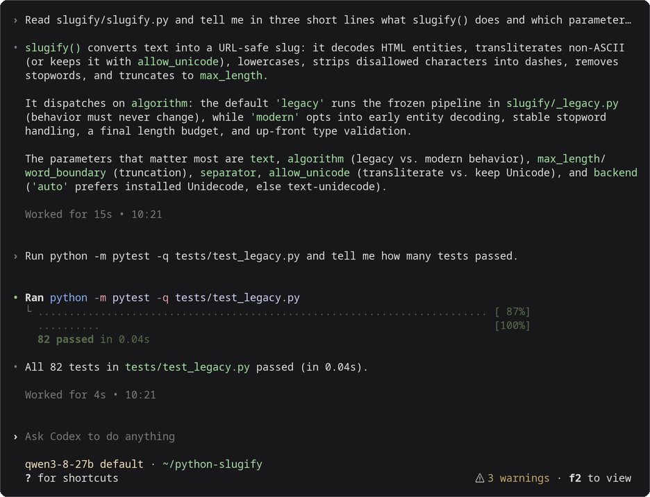

# Codex

Codex CLI can use a model that `mashbox` serves on your TPU as its LLM. This page sets it up for [Qwen3.8-27B](../models/qwen3-8-27b.md) on one TPU v6e chip. Your own Codex install and your `~/.codex/config.toml` stay as they are: Codex reads the settings below from a profile file that you name when you start it. These settings are for Codex CLI 0.165.0.



*Codex CLI 0.165.0, started with the command in step 2, working against Qwen3.8-27B on a TPU v6e-1. Drawn from the session's terminal text and colours; nothing edited.*

## Before you start

- The `mashbox` server and the SSH tunnel running, from [step 1 of Use with coding agents](../agents-on-tpu.md#1-start-the-server-and-the-tunnel).
- Codex CLI installed on your machine.

## 1. Save the profile

Codex reads a named profile from its own file next to `config.toml`. Save this as `~/.codex/mashbox.config.toml`:

```bash
cat > ~/.codex/mashbox.config.toml <<'EOF'
model_provider = "mashbox"
model = "qwen3-8-27b"
model_context_window = 32768
model_auto_compact_token_limit = 26214
model_reasoning_effort = "none"

[model_providers.mashbox]
name = "MASHBOX TPU"
base_url = "http://127.0.0.1:8000/v1"
wire_api = "responses"
EOF
```

## 2. Start it

In your project folder:

```bash
codex --profile mashbox
```

`codex` without `--profile mashbox` works as before.

## 3. Check it

```bash
codex exec --profile mashbox "Reply with one word: ready"
```

It ends with `ready`. Codex first prints a warning that it has no metadata for the model name (`Model metadata for qwen3-8-27b not found`): Codex works.

## What each setting does

| Setting | Why |
|---|---|
| `model_provider`, `[model_providers.mashbox]` | send every request to the tunnel, over the OpenAI Responses API (`wire_api = "responses"`); no API key is needed |
| `model_context_window` `32768` | the server's context |
| `model_auto_compact_token_limit` `26214` | Codex compacts at 80% of 32,768, so its summary still has room |
| `model_reasoning_effort` `"none"` | thinking off, even when your own config sets an effort, so long thinking cannot fill the context |

Codex 0.165 refuses a `[profiles.mashbox]` table inside `config.toml` when you start it with `--profile mashbox`: keep the profile in its own file as above.

## Context size

Start the server with `--ctx 32768 --slots 1`: one conversation of up to 32,768 tokens, which is what fits next to the 26.94 GB of weights on a v6e chip. Codex compacts at 26,214 tokens with the profile above. A prompt of 32,768 tokens or more is refused with `prompt is too long`.

## Caching

Codex is built to keep the start of its prompt the same: it sends the whole conversation on every request with the same instructions and tools first, and it adds a short note when your folder or the date changes instead of rewriting the top ([its own tests check this](https://github.com/openai/codex/blob/26ad281fd1ca712e4f0c7920a6273cf18c961b8a/codex-rs/core/tests/suite/prompt_caching.rs)). There is nothing to set for caching. Two things to know:

- **The title request.** After each of your messages the Codex app sends one more short request (about 4,700 tokens) to name the conversation. It asks for the title as JSON and keeps it only if the answer starts with `{` ([Codex source](https://github.com/openai/codex/blob/26ad281fd1ca712e4f0c7920a6273cf18c961b8a/codex-rs/tui/src/app/thread_title.rs)). The `mashbox` server does not apply the JSON format setting on the Responses API (llama-server does not either: [issue 21922](https://github.com/ggml-org/llama.cpp/issues/21922)), so the title is not kept and Codex asks again on the next message. The title request takes the chip's one slot for a moment; your conversation waits in host memory and comes back from there instead of being read again. Over the 9 turns of the [benchmark](../agents-on-tpu.md#how-the-server-reuses-prompts), that is 188,234 tokens brought back from host memory. `codex exec` sends no title request.
- **Compaction.** Codex compacts on your machine: it sends the history once to be summarised, then a new, shorter history. The new history is read in full (for example 12,132 tokens, 5.3 s to the first token).

## What you will see

The server's terminal shows one line per request. `cached_tokens` is the part of the prompt it did not have to read again, and `restored_tokens` the part of that which came back from host memory. After each of your messages you see the title request (`"tools": 0`), then your conversation coming back:

```text
{"event": "request", "t": "...", "api": "responses", "ua": "codex-tui/0.165.0 (Ubuntu 24.4.0; x86_64) xterm-256color (codex-tui; 0.165.0)", "session": "...", "queue_s": 1.266, "prompt_tokens": 4663, "cached_tokens": 4499, "restored_tokens": 4499, "new_tokens": 5, "tools": 0, "tool_calls": 0, "thinking": false, "finish": "stop", "dropped_tools": null, "batch_rows": 1, "ttft_s": 1.708, "total_s": 1.923}
{"event": "request", "t": "...", "api": "responses", "ua": "codex-tui/0.165.0 (Ubuntu 24.4.0; x86_64) xterm-256color (codex-tui; 0.165.0)", "session": "...", "queue_s": 0.152, "prompt_tokens": 15210, "cached_tokens": 14398, "restored_tokens": 14398, "new_tokens": 22, "tools": 15, "tool_calls": 0, "thinking": false, "finish": "stop", "dropped_tools": ["web_search"], "batch_rows": 1, "ttft_s": 0.913, "total_s": 1.587}
```

`dropped_tools` names Codex's web search tool, which runs on OpenAI's servers and is left out here. In the [9-turn benchmark](../agents-on-tpu.md#how-the-server-reuses-prompts), with the host-memory cache 86.3% of Codex's prompt tokens come from the cache, 4 of 38 requests read the whole prompt and the times to the first token add up to 104 s; without it, 51.8%, 21 of 38 and 192 s. See [How the server reuses prompts](../agents-on-tpu.md#how-the-server-reuses-prompts).

## Troubleshooting

| What you see | What to do |
|---|---|
| `Model metadata for qwen3-8-27b not found` | a warning only; Codex works |
| `--profile mashbox cannot be used while ... config.toml contains legacy ... [profiles.mashbox]` | move those lines to `~/.codex/mashbox.config.toml` as in step 1 |
| `wire_api = "chat" is no longer supported` | use `wire_api = "responses"` as in step 1 |
| `prompt is too long: N tokens > 32767 maximum` | start Codex with `--profile mashbox`, or start a new session |
| `Connection refused` | the tunnel is down; run [step 1](../agents-on-tpu.md#1-start-the-server-and-the-tunnel) again |

## Next

- [Use with coding agents](../agents-on-tpu.md): the server, the tunnel, and the three agents side by side.
- [Claude Code](claude-code.md) and [Pi](pi.md).
