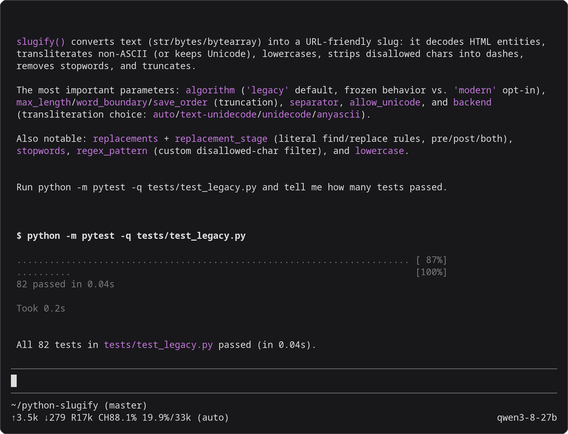

# Pi

Pi can use a model that `mashbox` serves on your TPU as its LLM. This page sets it up for [Qwen3.8-27B](../models/qwen3-8-27b.md) on one TPU v6e chip. Your own Pi setup in `~/.pi/agent` stays as it is: Pi reads the settings below from a profile folder of its own. These settings are for Pi 1.4.0.



*Pi 1.4.0, started with the command in step 2, working against Qwen3.8-27B on a TPU v6e-1. Drawn from the session's terminal text and colours; nothing edited.*

## Before you start

- The `mashbox` server and the SSH tunnel running, from [step 1 of Use with coding agents](../agents-on-tpu.md#1-start-the-server-and-the-tunnel).
- Pi installed on your machine.

## 1. Make the profile folder

```bash
mkdir -p ~/.pi/mashbox
cat > ~/.pi/mashbox/models.json <<'EOF'
{
  "providers": {
    "mashbox": {
      "baseUrl": "http://127.0.0.1:8000/v1",
      "api": "openai-completions",
      "apiKey": "local",
      "models": [{"id": "qwen3-8-27b", "name": "Qwen3.8-27B on MASHBOX TPU", "contextWindow": 32768, "maxTokens": 4096, "reasoning": false}]
    }
  }
}
EOF
cat > ~/.pi/mashbox/settings.json <<'EOF'
{
  "defaultProvider": "mashbox",
  "defaultModel": "qwen3-8-27b",
  "compaction": {"enabled": true, "reserveTokens": 6144, "keepRecentTokens": 8192}
}
EOF
```

## 2. Start it

In your project folder:

```bash
PI_CODING_AGENT_DIR=~/.pi/mashbox pi
```

`pi` alone works as before.

## 3. Check it

```bash
PI_CODING_AGENT_DIR=~/.pi/mashbox pi -p "Reply with one word: ready"
```

It ends with `ready`.

## What each setting does

| Setting | Why |
|---|---|
| `baseUrl`, `api` `openai-completions` | send every request to the tunnel, over OpenAI chat completions with tool calls; the server does not check `apiKey` |
| `contextWindow` `32768`, `maxTokens` `4096` | the server's context, and room for an answer |
| `reasoning` `false` | thinking off, so one long thought cannot use up the context |
| `reserveTokens` `6144`, `keepRecentTokens` `8192` | Pi compacts at 26,624 tokens and keeps the last 8,192. Pi's defaults (reserve 16,384, keep 20,000) do not fit a 32,768 context: after one large file read Pi stays stuck on `prompt is too long` |

Pi documents these in its [models](https://github.com/earendil-works/pi/blob/a92283056d915c758799fcd904948ff0cb42628c/packages/coding-agent/docs/models-configuration.md) page.

## Context size

Start the server with `--ctx 32768 --slots 1`: one conversation of up to 32,768 tokens, which is what fits next to the 26.94 GB of weights on a v6e chip. Pi compacts at 26,624 tokens with the settings above.

## Caching

There is nothing to set. Pi's system prompt is short (about 3,100 tokens with its tools), it sends the whole conversation every turn, and it only adds to the end, so almost every request starts with the one before it. Pi sends no extra requests of its own to this server: it warms a provider's cache only when the model entry declares cache lifetimes (`promptCache`), and the entry above declares none.

## What you will see

Pi's status line shows the cache as the server reports it: `R17k` is the prompt tokens read from cache so far in the session and `CH88.1%` the share of the last prompt. The server's terminal shows the same request:

```text
{"event": "request", "t": "...", "api": "chat", "ua": "pi/1.4.0 (linux; node/v24.14.0; x64)", "session": null, "queue_s": 0.014, "prompt_tokens": 6503, "cached_tokens": 5732, "restored_tokens": 0, "new_tokens": 22, "tools": 4, "tool_calls": 0, "thinking": false, "finish": "stop", "dropped_tools": null, "batch_rows": 1, "ttft_s": 0.363, "total_s": 1.004}
```

5,732 of 6,503 tokens is the 88.1%. In the [9-turn benchmark](../agents-on-tpu.md#how-the-server-reuses-prompts), 89.5% of Pi's prompt tokens come from the cache with the host-memory cache and 88.5% without it: Pi sends no extra requests, so it has little to gain.

## Troubleshooting

| What you see | What to do |
|---|---|
| `prompt is too long: N tokens > 32767 maximum` | start Pi with `PI_CODING_AGENT_DIR=~/.pi/mashbox` so it uses the compaction settings above, or start a new session |
| `Connection refused` | the tunnel is down; run [step 1](../agents-on-tpu.md#1-start-the-server-and-the-tunnel) again |

## Next

- [Use with coding agents](../agents-on-tpu.md): the server, the tunnel, and the three agents side by side.
- [Claude Code](claude-code.md) and [Codex](codex.md).
