# Run on Google Cloud TPU

From a Google account with no Cloud setup to a running model, then a deleted chip. Each step shows the Google Cloud console and the matching command. Commands are for Linux and macOS. On Windows, run them in the Google Cloud SDK Shell.

## What it costs

Google bills the chip from the moment it is created until it is deleted, running or idle. At Google's on-demand list price, one TPU v6e chip is $2.70 an hour, so 30 minutes is about $1.35 and a chip left on for a day is $64.80. One TPU v5e chip is about $1.20 an hour. Prices change by region: [cloud.google.com/tpu/pricing](https://cloud.google.com/tpu/pricing).

## Before you start

- A Google account.
- A payment method for the billing account. Google asks for one when you create a billing account (step 3).
- A terminal: Linux or macOS, or the Google Cloud SDK Shell on Windows.
- About 35 minutes from a new project to a deleted chip when a zone has a free chip, plus any wait for one ([FAQ](faq.md)). The chip bills for about 17 minutes of that: about $0.77 at the list price above.

## 1. Install the Google Cloud CLI and sign in

```bash
curl https://sdk.cloud.google.com | bash
exec -l $SHELL
gcloud --version
gcloud auth login
```

On macOS with Homebrew: `brew install --cask google-cloud-sdk`. Other systems: [cloud.google.com/sdk/docs/install](https://cloud.google.com/sdk/docs/install).

`gcloud auth login` opens the Google sign-in page in your browser. Use the same account in the console at [console.cloud.google.com](https://console.cloud.google.com).

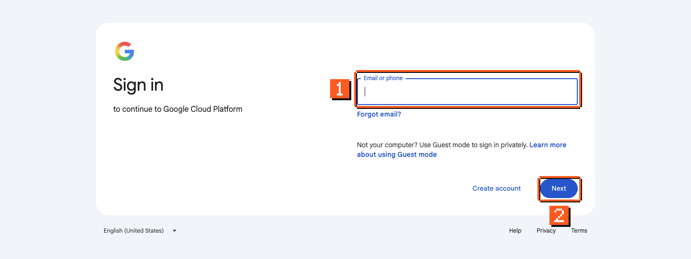

1. Enter your Google account email.
2. Click **Next** and finish signing in.

## 2. Make a project

Open [console.cloud.google.com/projectcreate](https://console.cloud.google.com/projectcreate).

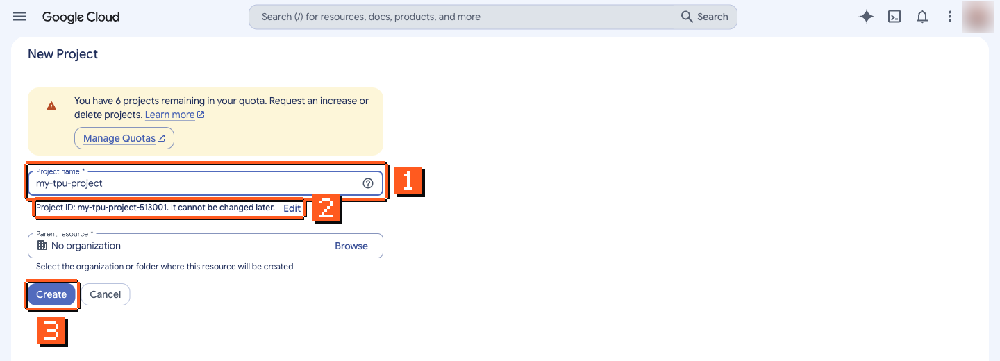

1. Type a project name, for example `my-tpu-project`.
2. Google adds a number to make the project ID unique (here `my-tpu-project-513001`). Write it down: every command below uses the ID, not the name, and it cannot be changed later.
3. Leave **Parent resource** as "No organization" and click **Create**.

Or from the terminal (pick an ID nobody has used):

```bash
gcloud projects create my-tpu-project-12345
gcloud config set project my-tpu-project-12345
```

## 3. Turn on billing

If your account already has a billing account, the console links a new project to it on its own. Check at [console.cloud.google.com/billing/linkedaccount](https://console.cloud.google.com/billing/linkedaccount) with your project selected.

If it says the project has no billing account:

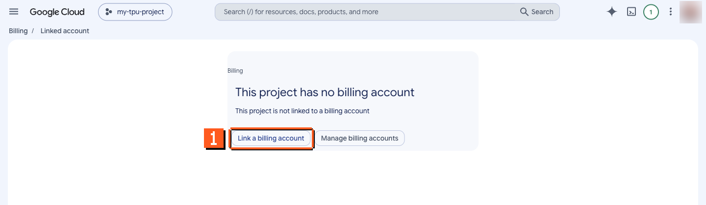

1. Click **Link a billing account**. If you have no billing account, use **Manage billing accounts** to create one first.

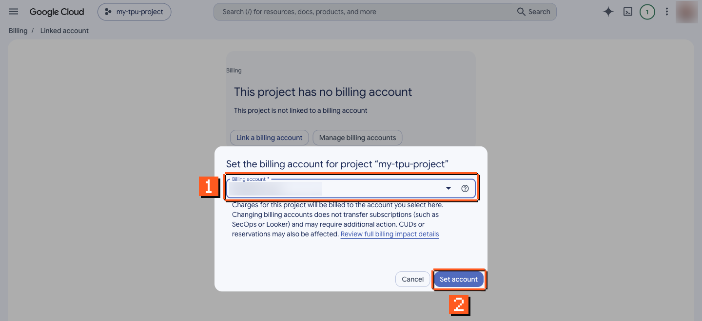

1. Pick your billing account.
2. Click **Set account**.

Or from the terminal:

```bash
gcloud billing accounts list
gcloud billing projects link my-tpu-project-12345 --billing-account=XXXXXX-XXXXXX-XXXXXX
```

## 4. Turn on the TPU API

Open [console.cloud.google.com/apis/library/tpu.googleapis.com](https://console.cloud.google.com/apis/library/tpu.googleapis.com) with your project selected.

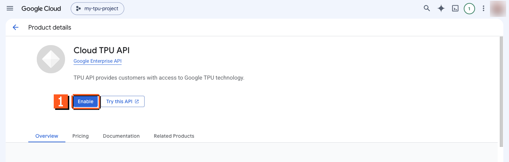

1. Click **Enable**. It takes about a minute.

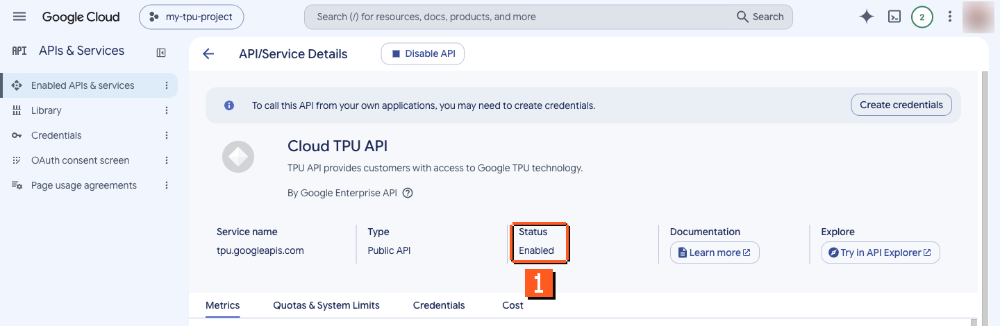

1. When it is done, the page shows **Status: Enabled**.

Or from the terminal:

```bash
gcloud services enable tpu.googleapis.com
```

## 5. Check your TPU quota

Open [console.cloud.google.com/iam-admin/quotas](https://console.cloud.google.com/iam-admin/quotas).

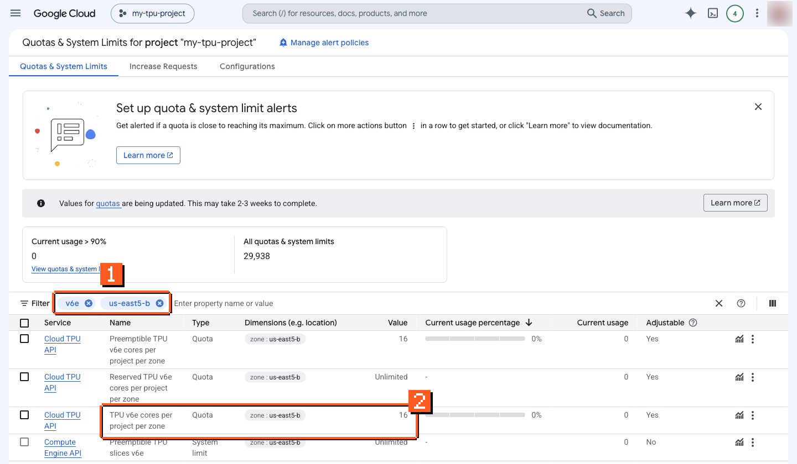

1. In **Filter**, type `v6e` and press Enter, then type your zone (for example `us-east5-b`) and press Enter.
2. The row **TPU v6e cores per project per zone** is the on-demand quota. One v6e-1 chip needs 1. The "Preemptible" row is for spot chips.

If the value is 0, ask for more:

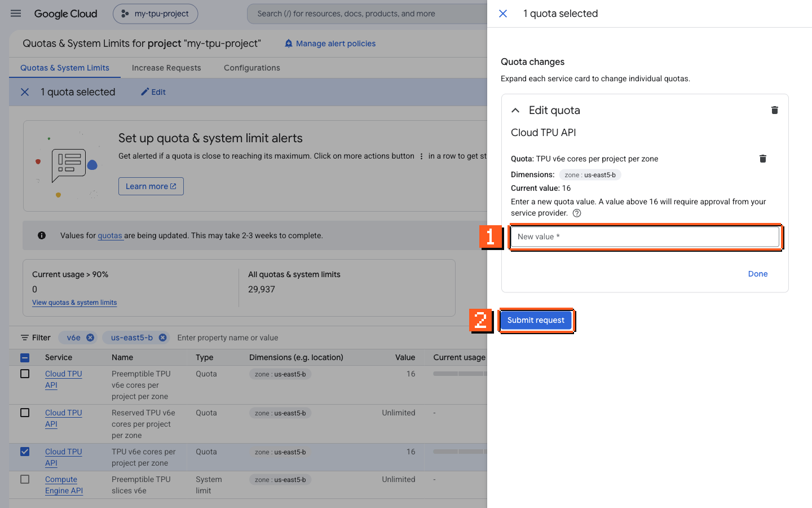

1. Click the row's menu (three dots), then **Edit quota**, and type the number of chips you need.
2. Click **Submit request**. Google decides; it can take minutes or days.

## 6. Create one chip

| Chip | `--accelerator-type` | `--version` | Zones to try first |
|---|---|---|---|
| TPU v6e | `v6e-1` | `v2-alpha-tpuv6e` | us-east5-b, europe-west4-a |
| TPU v6e slice of 4 chips | `v6e-4` | `v2-alpha-tpuv6e` | asia-northeast1-b, europe-west4-a, us-east5-b |
| TPU v5e | `v5litepod-1` | `v2-alpha-tpuv5-lite` | us-central1-a, us-south1-a, europe-west4-b |

This is not a full list: Google's [TPU regions and zones](https://cloud.google.com/tpu/docs/regions-zones) page lists every zone that offers each chip, and a zone outside the table may need quota first (step 5). When the zones in the table have no capacity, [queue a request](#if-no-zone-has-a-chip-queue-a-request) instead of trying zones one by one.

In the console, open [console.cloud.google.com/compute/tpus](https://console.cloud.google.com/compute/tpus).

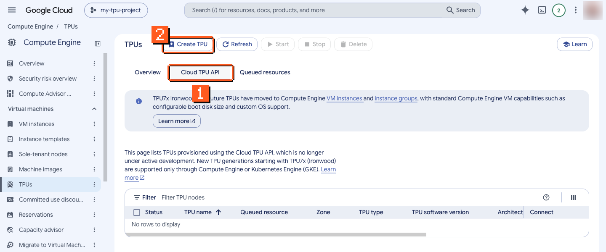

1. Click the **Cloud TPU API** tab. (The **VM instance** button on the Overview tab opens a different form, for Compute Engine VMs.)
2. Click **Create TPU**.

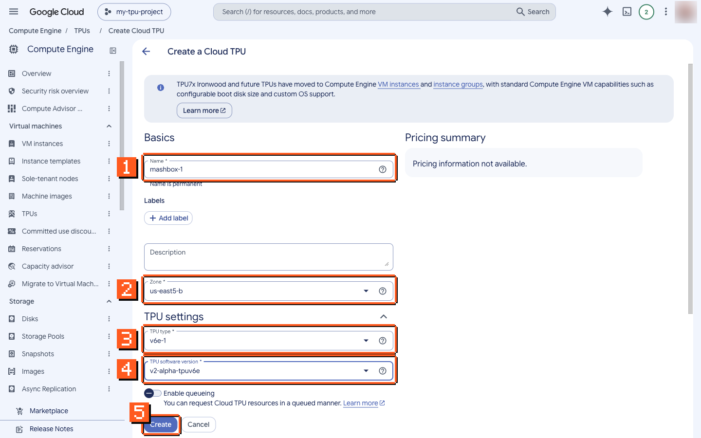

1. **Name:** `mashbox-1`.
2. **Zone:** `us-east5-b`.
3. **TPU type:** `v6e-1`.
4. **TPU software version:** `v2-alpha-tpuv6e`.
5. Leave **Enable queueing** off and click **Create**. This makes an on-demand chip, billed from now.

Or from the terminal:

```bash
gcloud compute tpus tpu-vm create mashbox-1 \
  --zone=us-east5-b --accelerator-type=v6e-1 --version=v2-alpha-tpuv6e
gcloud compute tpus tpu-vm describe mashbox-1 --zone=us-east5-b --format='value(state)'
```

Wait until the state is `READY`. A TPU v6e-1 in us-east5-b can take about 9 minutes.

If a zone has no free chips, the create command fails after about 2 minutes with `There is no more capacity in the zone`. Run it again with the next zone in the table, and use that zone in every command after it.

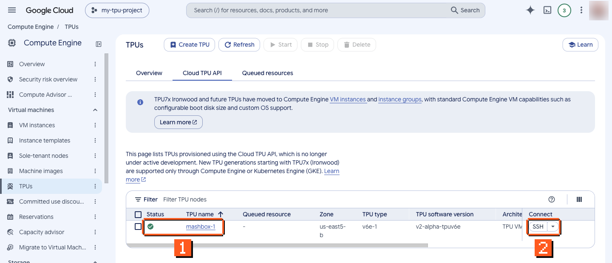

1. A green check means the chip is ready.
2. **SSH** opens a shell in your browser (next step).

- **Quota error:** go back to step 5.
- **No capacity:** try the next zone in the table, or queue a request (below).

### If no zone has a chip: queue a request

A queued request waits in a zone until Google has a chip, then makes it under the name you give. It costs nothing while it waits; the chip bills from the moment it exists.

```bash
gcloud compute tpus queued-resources create mashbox-1-request --node-id=mashbox-1 \
  --zone=us-east5-b --accelerator-type=v6e-1 --runtime-version=v2-alpha-tpuv6e
gcloud compute tpus queued-resources describe mashbox-1-request --zone=us-east5-b --format='value(state.state)'
```

The software version goes in `queued-resources create --runtime-version`, where `tpu-vm create` uses `--version`. Run the `describe` line until the state is `ACTIVE`:

| State | What it means |
|---|---|
| `WAITING_FOR_RESOURCES` | the request waits for a free chip in the zone; nothing bills |
| `PROVISIONING` | Google is making the chip |
| `ACTIVE` | the chip `mashbox-1` exists and bills: use it like a chip you created, from step 7 on |

A queued TPU v6e-1 request in us-east5-b can take about 9 min 55 s to go `ACTIVE` with a `READY` chip. A chip you queued is deleted with its request ([step 8](#8-delete-the-chip)).

## 7. Connect, install and run

From the console, click **SSH** on the chip's row. The first time, Google asks you to allow it:

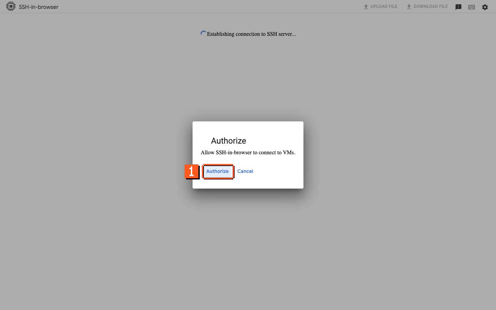

1. Click **Authorize**.

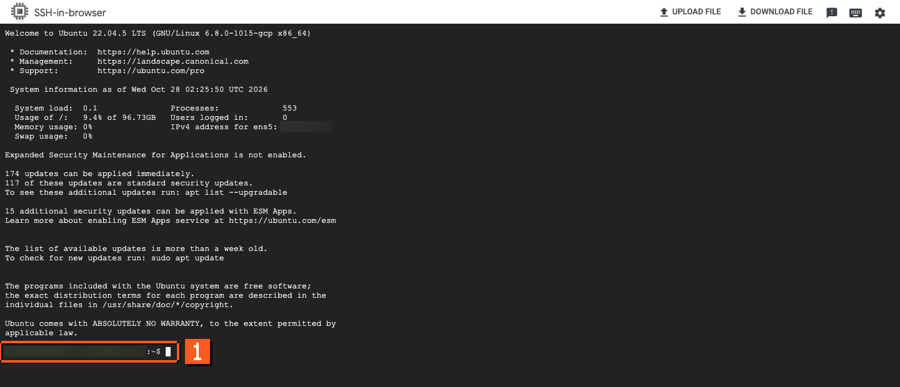

1. You now have a shell on the chip's machine.

From your own terminal, check that the chip shows up:

```bash
gcloud compute tpus tpu-vm ssh mashbox-1 --zone=us-east5-b \
  --command='python3 -m pip install -q "jax[tpu]" && python3 -c "import jax; print(jax.devices())"'
```

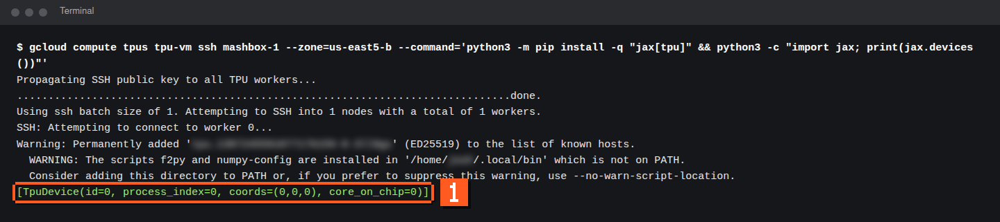

1. A `TpuDevice` line means JAX sees the chip. The first SSH also copies your SSH key to the chip ("Propagating SSH public key").

Install and run a model:

```bash
gcloud compute tpus tpu-vm ssh mashbox-1 --zone=us-east5-b \
  --command='python3 -m pip install uv && python3 -m uv tool install --python 3.12 "mashbox[tpu]" && ~/.local/bin/mashbox run qwen3-8-27b --prompt "Hello"'
```

The chip's system Python is 3.10, and JAX for TPU needs Python 3.12. So the command first installs [uv](https://docs.astral.sh/uv/) with pip, and uv installs `mashbox` with its own Python 3.12. The `mashbox` command lands in `~/.local/bin`; the commands in these docs use that full path because the folder is not on your `PATH` until you next log in. pip and uv both print a warning saying so; that is expected. On a new TPU v6e-1 the install takes 5 to 7 s, and the model's first start downloads the 26.9 GB weights file; with it on disk, a start is ready in 69.6 s.

This runs Qwen3.8-27B, which fits on the one chip from step 6. For another model, swap in its `install` and `run` commands from [models.json](../models.json) and create the chip type its row lists in step 6. A model that writes files (for example a video) leaves them on the chip; copy them to your machine with `gcloud compute tpus tpu-vm scp mashbox-1:<file> . --zone=us-east5-b` before step 8.

## 8. Delete the chip

In the console:

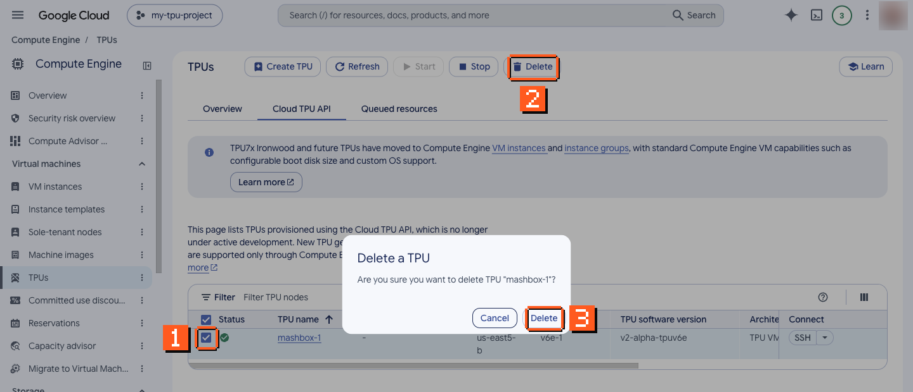

1. Tick the chip's row.
2. Click **Delete**.
3. Click **Delete** again to confirm.

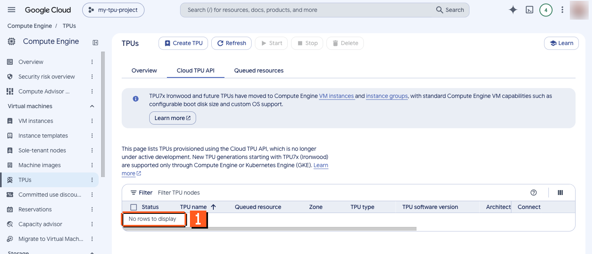

1. Deleting a TPU v6e-1 takes about 2.5 minutes. When the list says "No rows to display", the chip is gone.

Or from the terminal:

```bash
gcloud compute tpus tpu-vm delete mashbox-1 --zone=us-east5-b --quiet
gcloud compute tpus tpu-vm list --zone=us-east5-b
```

The list must not show `mashbox-1`. Until it is gone, it bills.

If you made the chip with a queued request, delete the request; `queued-resources delete --force` deletes the chip with it:

```bash
gcloud compute tpus queued-resources delete mashbox-1-request --zone=us-east5-b --force --quiet
gcloud compute tpus queued-resources list --zone=us-east5-b
```

The delete can take about 93 s. Both lists (`tpu-vm list` and `queued-resources list`) must be empty of your names.

## Check it worked

Two outputs prove it: the `TpuDevice` line in step 7, and the chip list without `mashbox-1` in step 8.

## Clean up

Step 8 is the clean-up. A chip you forget keeps billing: $64.80 a day for one TPU v6e chip at the list price above. When in doubt, list your chips and queued requests in every zone you used:

```bash
gcloud compute tpus tpu-vm list --zone=us-east5-b
gcloud compute tpus queued-resources list --zone=us-east5-b
```

## Troubleshooting

| What you see | What to do |
|---|---|
| an error that mentions quota when you create the chip | request TPU quota for that zone (step 5) |
| no capacity in the zone | try the next zone in the step 6 table, or [queue a request](#if-no-zone-has-a-chip-queue-a-request) |
| the TPU API is not enabled | turn it on (step 4) |
| the **VM instance** button opens a Compute Engine VM form | that is a different product; use the **Cloud TPU API** tab, then **Create TPU** (step 6) |
| SSH in the browser asks you to authorize | click **Authorize**; it asks once (step 7) |
| `There is no more capacity in the zone "us-east5-b"` | no free chips there right now: create the chip in the next zone of the step 6 table and use that zone in every later command, or [queue a request](#if-no-zone-has-a-chip-queue-a-request) |
| `User does not have permission to submit requests for accelerator type "v6e-1" in location ...` | your project has no on-demand quota for that chip in that zone: pick a zone from the step 6 table, or ask for quota there (step 5) |
| `ERROR: No matching distribution found for jax[tpu]==0.11.2` | plain `pip install "mashbox[tpu]"` ran on the chip's Python 3.10; use the install line from step 7, which gets Python 3.12 through uv |
| `mashbox: command not found` | use the full path `~/.local/bin/mashbox`, or log in again so `~/.local/bin` is on your `PATH` |
| `429 Too Many Requests` from `cdn.hf.co` during the download | Hugging Face's Xet transfer is limiting the download: run the command again. `mashbox` downloads over plain HTTPS unless `HF_HUB_DISABLE_XET=0` is set |
| `The TPU is already in use by another process` | one process at a time can use the chip: stop the other one (for example a server in another SSH session) and run again |
| `<model> is not in mashbox <version>` | that model is not in the installed version: pick one from the Models pages |

## Next

- [Use with coding agents](agents-on-tpu.md): Claude Code, Codex and Pi on the model you serve.
- [Qwen3.8-27B on TPU](models/qwen3-8-27b.md): serve it with an OpenAI-compatible API.
- [TPU v6e and v5e](chips.md): which chip to pick.
