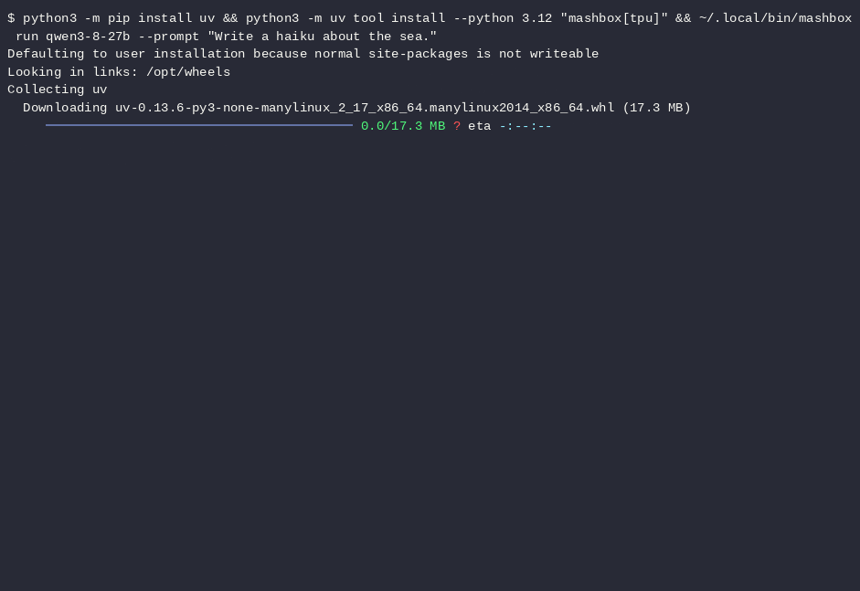

# Qwen3.8-27B on TPU

[Qwen3.8-27B](https://huggingface.co/Qwen/Qwen3.8-27B) by Qwen, running on Google Cloud TPU (one TPU v6e chip, or a host of 4 chips: TPU v5e-4 or v6e-4), with an OpenAI-compatible server. The model code is plain JAX in [src/mashbox/models/qwen3_8_27b](../../src/mashbox/models/qwen3_8_27b). The weights come as one BSHJ file from [mashbox-labs/Qwen3.8-27B-TPU](https://huggingface.co/mashbox-labs/Qwen3.8-27B-TPU), and decoding uses our compiled TPU kernels (Culet).

## What it is



Qwen3.8-27B on a new TPU v6e-1: install, weights download, first answer. Sped up 10x, pauses over 2 s cut to 2 s.

How it runs:

- **Port:** plain JAX in [src/mashbox/models/qwen3_8_27b](../../src/mashbox/models/qwen3_8_27b).
- **Kernels:** the compiled TPU kernels ship as one bundle in [mashbox-labs/Qwen3.8-27B-TPU](https://huggingface.co/mashbox-labs/Qwen3.8-27B-TPU) under `kernels/`, without source; `mashbox run` downloads it and checks its sha256 against `models.json`. On a chip or JAX version the bundle was not built for, the model runs on plain JAX and prints one line saying so.
- **Weights:** one BSHJ file from [mashbox-labs/Qwen3.8-27B-TPU](https://huggingface.co/mashbox-labs/Qwen3.8-27B-TPU) (see [Variants](#variants)).

## What you need

| | TPU v6e (v6e-1) | TPU v5e (v5e-4) | TPU v6e slice (v6e-4) | TPU v5p slice (v5p-8) |
|---|---|---|---|---|
| Status | Supported: one chip (v6e-1) | Supported: a v5e-4 (4 chips), split across them automatically; one v5e chip is too small: the weights alone are about 27 GB and a v5e chip has 16 GB | Supported: 4 chips, split across them automatically | Not tested yet |
| Create with | `--accelerator-type=v6e-1 --version=v2-alpha-tpuv6e` | `--accelerator-type=v5litepod-4 --version=v2-alpha-tpuv5-lite` | `--accelerator-type=v6e-4 --version=v2-alpha-tpuv6e` | |

One TPU v6e chip is $2.70 an hour at Google's on-demand list price. The chip bills from create to delete. Context is 2,048 tokens per request with 8 request slots. On a host of 4 chips, `mashbox run` splits the model across them by itself (`--tensor-parallel-size`, in [Options](#options)). The commands on this page use a v6e-1.

You also need the Google Cloud CLI set up: [google-cloud.md](../google-cloud.md) does that from a new Google account.

## Install

On the chip, the package installs with one line; the command in [Run](#run) does it for you:

```bash
python3 -m pip install uv && python3 -m uv tool install --python 3.12 "mashbox[tpu]"
```

The chip's system Python is 3.10 and JAX for TPU needs 3.12, so pip installs [uv](https://docs.astral.sh/uv/), and uv installs `mashbox` with its own Python 3.12. The `mashbox` command goes to `~/.local/bin`; the commands on this page use that full path. uv prints a warning that `~/.local/bin` is not on your `PATH` (pip may print one too): that is expected. The download may print a Hugging Face warning about unauthenticated requests and `HF_TOKEN`: no token is needed, the model repos are public. On a new TPU v6e-1 the install takes 5 to 7 s.

## Run

From your own machine, with the Google Cloud CLI set up ([google-cloud.md](../google-cloud.md) does that from a new Google account):

```bash
gcloud compute tpus tpu-vm create mashbox-1 --zone=us-east5-b --accelerator-type=v6e-1 --version=v2-alpha-tpuv6e
gcloud compute tpus tpu-vm ssh mashbox-1 --zone=us-east5-b --command='python3 -m pip install uv && python3 -m uv tool install --python 3.12 "mashbox[tpu]" && ~/.local/bin/mashbox run qwen3-8-27b --prompt "Write a haiku about the sea."'
gcloud compute tpus tpu-vm delete mashbox-1 --zone=us-east5-b --quiet
```

The first run downloads the tokenizer and config from Qwen's repo (pinned revision), the weights file and the kernel bundle, and checks each against the sha256 in [models.json](../../models.json). On a new TPU v6e-1 this takes about 279.2 s and depends on the download speed ([first start](../faq.md#why-is-the-first-start-slow-and-later-starts-fast)).

If the create command says there is no capacity, try the other zones in [step 6 of the setup guide](../google-cloud.md#6-create-one-chip) or [queue a request](../google-cloud.md#if-no-zone-has-a-chip-queue-a-request) for the chip `mashbox-1`, and use its zone in every later command. A chip you queued is deleted with its request: `gcloud compute tpus queued-resources delete REQUEST_NAME --zone=ZONE --force --quiet` ([step 8](../google-cloud.md#8-delete-the-chip)).

### Serve it

```bash
gcloud compute tpus tpu-vm ssh mashbox-1 --zone=us-east5-b --command='~/.local/bin/mashbox run qwen3-8-27b' -- -L 8000:127.0.0.1:8000
```

The server listens on 127.0.0.1:8000 on the chip, and the SSH tunnel brings it to port 8000 on your machine. It prints `"event": "ready"` when it takes requests. Then, from your machine:

```bash
curl -s http://127.0.0.1:8000/v1/chat/completions -H 'Content-Type: application/json' \
  -d '{"model": "qwen3-8-27b", "messages": [{"role": "user", "content": "Hello"}], "max_tokens": 128}'
```

Closing the tunnel does not stop the server on the chip. To stop it, first end the serve command on your machine (Ctrl-C in its terminal, or stop its process if it runs in the background or from a script): while that command runs, gcloud retries it when the server stops and starts the server again. Then stop the server on the chip:

```bash
gcloud compute tpus tpu-vm ssh mashbox-1 --zone=us-east5-b --command='pkill -INT -f "^/home/.*/mashbox run"'
```

`-INT` sends the same signal as Ctrl-C, and the `^/home/` start keeps the pattern from matching the shell that runs it.

Wait 10 s before you start it again ([why](../faq.md#how-do-i-stop-a-server-and-what-if-the-tpu-will-not-start-again)). Then delete the chip with the last line of [Run](#run), or with the queued request if you queued it.

## Options

`~/.local/bin/mashbox run qwen3-8-27b [options]`

<!-- cli:start run -->
| Option | Default | What it does |
|---|---|---|
| `MODEL` |  | model id, as in models.json (e.g. qwen3-8-27b), a .gguf file, or a Hugging Face GGUF repo with an optional quant tag (e.g. unsloth/Qwen3.8-27B-GGUF or unsloth/Qwen3.8-27B-GGUF:Q8_0) |
| `--weights FILE` |  | a local .bshj file instead of the download (its sha256 is still checked) |
| `--no-kernels` | off | plain JAX only: a catalog model runs without its TPU kernels (slower decode, same outputs within rounding) |
| `--prompt TEXT` |  | answer one chat turn, print it and exit; without it, start the server |
| `--thinking` | off | thinking mode for --prompt |
| `--max-tokens N` | `512` | most new tokens for --prompt |
| `--temperature T` | `0.0` | sampling temperature for --prompt; 0 is greedy |
| `--top-p P` | `1.0` | nucleus sampling cut for --prompt |
| `--top-k K` | `0` | top-k cut for --prompt; 0 means none |
| `--seed N` | `0` | seed for sampled --prompt answers |
| `--host H` | `127.0.0.1` | server address; keep it on 127.0.0.1 and use an SSH tunnel |
| `--port N` | `8000` | server port; 0 picks a free one, named in the "listening" log line (and "ui" with --ui) |
| `--api-key-file FILE` |  | require an API key from FILE on /v1 requests: one per line, a key or a key then its tenant's name; keys of one tenant share one prompt cache and one waiting queue, and a key without a name is its own tenant; only you may read or write FILE (chmod 600). Also MASHBOX_API_KEY=k1,k2. Default: none on 127.0.0.1, and on any other --host a key made in ~/.config/mashbox/api-key |
| `--ui` | off | also serve the MASHBOX Chat page at http://127.0.0.1:<port>/ |
| `--ctx N` | `2048` | context per request in tokens (prompt plus answer) |
| `--slots N` | `8` | requests decoded together; a catalog model's kernels are built for 8 and other values run it on plain JAX; at the default, a GGUF file takes as many as fit the chip's memory |
| `--steps N` | `8` | decode steps per device call |
| `--mtp K` |  | speculative decoding with the model's own multi-token-prediction head: K drafts per verify pass (1 to 3; 0 = off). Default: on only on chips where it passed its checks, else off. Uses the model's draft file (Qwen3.8-27B: --mtp 2); one chip only |
| `--mtp-file FILE` |  | a local draft .bshj file instead of the download (its sha256 is still checked) |
| `--speculation SPECULATION` |  | speculative decoding. auto (default): the first drafter that applies to the model file, in this order: 1 a trained drafter made for this model (not in this release); 2 the model's own MTP head; 3 a smaller draft model with the same tokenizer (only one you give with --draft-model); 4 n-gram over the request's own text (llama, qwen2, qwen3 and qwen35 GGUF files), on only where it passed its checks on this chip (Qwen3.8-27B reads its MTP head only); off; or force one kind (then it says 'not gated on this chip'). One chip only (`auto`, `off`, `mtp`, `ngram`, `draft`) |
| `--draft-k K` |  | drafts per verify pass for a drafter you pick: ngram 1 to 8 (default 3); draft 1 to 8 (default 3); mtp 1 to the head's k_max (Qwen3.8-27B: 1 to 3, default 2) |
| `--draft-model FILE` |  | --speculation draft with this draft model: a smaller GGUF file or repo (as the model argument) with the same tokenizer, a llama, qwen2, qwen3, exaone or granite file; for a GGUF model only. Its weights and cache take chip memory next to the model's |
| `--tensor-parallel-size N` | `0` | chips to split the model across, as vLLM (1, 2 or 4); default: the chips of this host, at most 4 (1 on a TPU v6e-1, 4 on a TPU v5e-4 or v6e-4) |
| `--cache-dir DIR` |  | compile cache (default ~/.cache/mashbox/xla, or JAX_COMPILATION_CACHE_DIR) |
| `--no-warm` | off | skip compiling the first request's programs before ready |
| `--no-prefix-cache` | off | prefill every prompt in full (by default the server reuses a cached prompt start, see docs/agents-on-tpu.md) |
| `--cache-ram MIB` | `8192` | host memory for saved prompt states, as llama-server's --cache-ram: a conversation that loses its slot is kept here and restored when it comes back (default 8192, 0 = off) |
| `--ctx-checkpoints N` | `8` | prompt points kept per slot where a cached prompt can resume (default 8) |
| `--checkpoint-min-step N` | `8192` | minimum tokens between kept user-message points, as llama-server (default 8192) |
<!-- cli:end -->

`~/.local/bin/mashbox download qwen3-8-27b` fetches and checks the files without loading them. `~/.local/bin/mashbox env` prints the versions and chip for bug reports.

### Recommended settings

The default is greedy (temperature 0): the model always takes its most likely next token. For sampled answers with thinking off, Qwen's settings are below; send them in each server request.

| Request field | Our default | Qwen's settings, thinking off |
|---|---|---|
| `temperature` | 0 (greedy) | 0.7 |
| `top_p` | 1.0 | 0.8 |
| `top_k` | 0 (no cut) | 20 |
| `presence_penalty` | 0 | 1.5 |

With these settings the `mashbox` server gives 33.0 tokens/s for one request at a time on a TPU v6e-1 ([Compared with vLLM TPU](#compared-with-vllm-tpu-on-the-same-chip)).

### Server routes and sampling

<!-- api:start -->
Routes: `GET /v1/health`, `GET /health`, `GET /`, `HEAD /v1/health`, `GET /v1/models`, `GET /v1/models/{model}`, `POST /v1/chat/completions`, `POST /v1/completions`, `POST /v1/messages`, `POST /v1/messages/count_tokens`, `POST /v1/responses`, `GET /metrics`, `GET /openapi.json`. Each one, with every request field and response shape: [Server API](../server-api.md); the same as an OpenAPI file at `GET /openapi.json`. Send `"stream": true` for server-sent events. Sampling fields on every generating route: `max_tokens`, `max_completion_tokens`, `temperature`, `top_p`, `top_k`, `min_p`, `seed`, `stop`, `stop_sequences`, `repetition_penalty`, `frequency_penalty`, `presence_penalty`, `n`; temperature 0 (the default) is greedy.
<!-- api:end -->

Thinking mode: `"chat_template_kwargs": {"enable_thinking": true}`. Requests sent within 20 ms of each other start together, and up to 8 share the chip at once. A request that arrives while others are answering takes a free slot at the next device call and runs alongside them; when all 8 slots are busy it waits for one.

## Variants

| File | Format | Size | Bits per weight | Quality vs full precision | Speed on TPU v6e-1 |
|---|---|---|---|---|---|
| `Qwen3.8-27B-BQ8_R.bshj` | BSHJ | 26.94 GB | 8.01 | mean KL 0.00065, top-1 agreement 99.72% vs bf16 (8 prompts x 32 tokens) | 38.6 tokens/s for 1 request, 269 tokens/s for 8 |

Made from the original bf16 weights: each large weight matrix (and the embedding and output layers) is stored as int8 values with one f32 scale per output row; norms and the small linear-attention tensors keep their original dtype. The original weights stay at [Qwen/Qwen3.8-27B](https://huggingface.co/Qwen/Qwen3.8-27B). Speed measured on TPU v6e-1 (64-token prompt, 128 new tokens, greedy, default options); quality measured against Hugging Face transformers in bf16 with the same weights.

## Performance

Measured on one TPU v6e-1 (on demand, zone europe-west4-a), set up on a new chip as this page shows: `mashbox` 0.1.0 with its kernel bundle and JAX 0.11.2 for TPU (`~/.local/bin/mashbox env` prints the full list), through the server with the default options (greedy, `--ctx 2048 --slots 8`). Chat prompts of about 30 tokens, 128 new tokens per request.

| What | Result |
|---|---|
| 1 user | 37.5 tokens/s; first token after 52 ms |
| 8 users sending at the same moment, streamed | first token after 0.11 s for each of the 8 |
| 8 users, each sending a new request as soon as its answer came back, for 60 s | 258 tokens/s in total; a request took 4.0 s (median) |
| Install (`pip install uv` and `uv tool install`) | 5 to 7 s |

Start to ready with `mashbox` 0.1.2 on one TPU v6e-1 (on demand), the weights file already on disk, from starting the server until it answers its ready check. Every prefill and decode program is compiled or loaded before the server says ready.

| What | Result |
|---|---|
| First start, empty compile cache | 326.6 s |
| With the shipped compile cache | 69.6 s |
| With the shipped compile cache, `--ctx 32768 --slots 1` | 32.6 s |

The engine on its own does 38.6 tokens/s for 1 request and 269 tokens/s for 8 ([Variants](#variants)). On TPU v6e with JAX 0.11.2, `mashbox run` also downloads the compile cache from the model repo (checked by sha256 like the weights), so the first start loads its compiled programs instead of compiling them. Any other chip or JAX version compiles on first use and keeps the result. Download speed depends on the zone and the day.

Quality from the installed package on the same chip: mean KL 0.00065 and top-1 agreement 99.72% against Hugging Face transformers in bf16 on 8 fixed prompts (367 token positions), the same as in [Variants](#variants).

### Speculative decoding

`mashbox run` drafts tokens with the model's own multi-token-prediction (MTP) head, which Qwen ships with the weights: the head proposes 2 tokens, the main weights check them in one pass and keep the ones they agree with, plus one of their own. It is off by default: `--mtp 2` turns it on with 2 drafts per pass (`--mtp K` takes 1 to 3). It uses the draft file `Qwen3.8-27B-MTP-BQ8_R.bshj`, downloaded with the weights and checked by sha256 like them. It runs on one chip: `--mtp` with `--tensor-parallel-size` above 1 stops with an error. Greedy, sampled and penalised requests all use it.

| Greedy, 256 new tokens, 8 chat prompts | `--mtp 2` | Off (default) |
|---|---|---|
| 1 request at a time (median of the 8 prompts) | 74.84 tokens/s | 37.77 tokens/s |
| The 8 prompts at once (total) | 436.87 tokens/s | 244.69 tokens/s |

The output is not always the same as without it. With greedy decoding the text was identical on 5 of 8 prompts. Where it differs, the two best next tokens had equal scores, or scores one bf16 step apart, and a pass that checks 3 tokens rounds differently from one that reads 1. The engine's own two paths without speculation (compiled kernels and plain JAX) split at such ties too: they gave identical text on 3 of 8 prompts. Sampled requests keep the token the sampler draws without speculation at each position (same settings and seed), so each token is drawn from the model's own distribution.

The other tables on this page were measured with `mashbox` 0.1.0, which decodes without speculation.

### Compared with vLLM TPU on the same chip

Measured on one TPU v6e-1 (on demand, zone us-east5-b), one server on the chip at a time, the same OpenAI chat requests to both (streamed, 256 new tokens, thinking off). Ours: `mashbox` 0.1.0 with `Qwen3.8-27B-BQ8_R.bshj` (26.94 GB, 8.01 bits per weight) and default options. vLLM: vllm-tpu 0.32.0 with Qwen's own 8-bit file [Qwen/Qwen3.8-27B-FP8](https://huggingface.co/Qwen/Qwen3.8-27B-FP8), the closest like-for-like.

| What | mashbox | vLLM TPU 0.32.0 |
|---|---|---|
| Starts on one v6e-1 with default settings | yes | no: Qwen's bf16 weights run out of chip memory; the FP8 weights start only with `--max-num-seqs 8 --gpu-memory-utilization 0.98 --no-enable-prefix-caching` |
| Start to ready, weights already on disk, empty compile caches | 326.6 s | 1,606.7 s |
| 1 request at a time, short prompts, greedy | 38.1 tokens/s | 31.4 tokens/s |
| 1 request at a time, 790-token prompts, greedy | 37.0 tokens/s | 31.0 tokens/s |
| 1 request at a time, sampled (temperature 0.7, top_p 0.8, top_k 20) | 33.0 tokens/s | 23.7 tokens/s |

## Use it with your coding agent

Claude Code, Codex and Pi can use Qwen3.8-27B as their LLM: start the server with `--ctx 32768 --slots 1` and point the agent at it, as in [Use with coding agents](../agents-on-tpu.md). [AGENTS.md](../../AGENTS.md) gives an agent the rules and the steps to set up the chip itself, and tells it to ask you before anything that costs money.

## Troubleshooting

| What you see | Why | What to do |
|---|---|---|
| one line saying the model runs on plain JAX | the kernel bundle was not built for this chip or JAX version, or `--slots` is not 8 | use TPU v6e and the default `--slots 8`; `~/.local/bin/mashbox env` shows the chip and versions |
| out of memory | another process holds the chip, or `--ctx`/`--slots` are above the defaults | run on a TPU v6e-1 with nothing else on it, with `--ctx 2048 --slots 8` |
| `sha256 ... does not match the pinned ...` | a download was cut off or changed | delete the file and download again, as the message says |
| `ERROR: No matching distribution found for jax[tpu]==0.11.2` | plain `pip install "mashbox[tpu]"` ran on the chip's Python 3.10; JAX for TPU needs 3.12 | use the install line in [Install](#install) |
| `mashbox: command not found` | `~/.local/bin` is not on your `PATH` until you log in again | use the full path `~/.local/bin/mashbox` |
| `429 Too Many Requests` from `cdn.hf.co`, then a traceback | Hugging Face's Xet transfer is limiting the download | run the command again; `mashbox` downloads over plain HTTPS unless you set `HF_HUB_DISABLE_XET=0`, so remove that setting if you added it |
| `The TPU is already in use by another process` | one process at a time can use the chip, for example a server you started in another SSH session | stop that process (Ctrl-C in its session) and run again; if `sudo lsof -w /dev/vfio/0` shows no process, the lock file is left over: `sudo rm /tmp/libtpu_lockfile`, as the message says |
| `There is no more capacity in the zone` when you create the chip | no free TPU v6e chips in that zone right now | create it in another zone from [step 6 of the setup guide](../google-cloud.md#6-create-one-chip) and use that zone in every later command |

## FAQ

- **Does it run on TPU v5e?** Supported: a v5e-4 (4 chips), split across them automatically; one v5e chip is too small: the weights alone are about 27 GB and a v5e chip has 16 GB.
- **Can several people use one server?** Yes. Up to 8 requests share the chip at once; a request that arrives while others are answering takes a free slot at the next device call, or waits for one when all 8 are busy. With 8 users each sending a new request as soon as the last answer came back, the server gave 258 tokens/s in total on TPU v6e-1 ([Performance](#performance)).
- **How do I turn on thinking mode?** `--thinking` for `--prompt`, or `"chat_template_kwargs": {"enable_thinking": true}` in a server request.

## Changelog

| Version | What changed |
|---|---|
| 0.1.2 | Runs on TPU v6e-1, a TPU v5e-4 and a TPU v6e-4 slice: the `--chip` option picks the host for a new chip, tensor parallel defaults to the host's chips, and a setting that cannot fit stops before any download with the setting that does. Every prefill and decode program compiles, or loads from the new compile cache for TPU v6e, before the server says ready. Responses carry a llama-server style `timings` block, and a half-closed client socket ends its request. Prompt cache in host memory for coding agents (`--cache-ram`, `--ctx-checkpoints`, `--checkpoint-min-step`). OpenAPI description at `GET /openapi.json`. |
| 0.1.1 | Server: `/v1/completions` without streaming returns `choices[0].text`, as OpenAI does. `mashbox tpu status` and `mashbox tpu down`: a failed chip list shows Google's error instead of reading as no chips. `mashbox tpu up`: the tunnel stops when the chip is gone; the max lifetime runs on a wall-clock timer; a create that may have reached Google before an error (such as an expired sign-in) is deleted by name, or `up` prints its name and the delete command. Docs: settings for long Claude Code, Codex and Pi sessions, and installing on your own computer. |
| 0.1.0 | First release: one TPU v6e chip, OpenAI-compatible server, compiled kernels for 8 request slots, compile cache for TPU v6e. |

## Credits and licences

Qwen3.8-27B is made by Qwen: [Qwen/Qwen3.8-27B](https://huggingface.co/Qwen/Qwen3.8-27B). Model weights: Apache-2.0, Qwen's licence as published with Qwen3.8-27B, kept unchanged in [licenses/qwen3-8-27b/LICENSE](../../licenses/qwen3-8-27b/LICENSE).

Our code in this repo: Apache-2.0 (see [LICENSE](../../LICENSE)). Compiled kernels: see [LICENSE-KERNELS](../../LICENSE-KERNELS).
